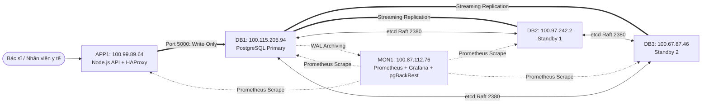

# HỆ THỐNG CƠ SỞ DỮ LIỆU DỰ PHÒNG CHO QUẢN LÝ BỆNH VIỆN TRÊN NỀN TẢNG ĐA MÁY CHỦ UBUNTU SERVER

**Đề tài**: *Nghiên cứu và xây dựng hệ thống cơ sở dữ liệu dự phòng cho hệ thống quản lý bệnh viện trên nền tảng đa máy chủ Ubuntu Server*  
**Công nghệ chính**: Ubuntu Server 22.04 LTS (Jammy) • PostgreSQL 14 • Patroni • etcd v3 (3-Node Quorum) • HAProxy • Node.js Express • pgBackRest • Prometheus & Grafana • **Mạng ảo Tailscale Mesh**

---

## 1. Tổng Quan Kiến Trúc 5 Máy Chủ (Kết Nối Qua Tailscale)



### Phân vai trò các máy chủ (Tailscale Mesh):
| Máy | Hostname | IP Tailscale thực tế | Thành phần & Dịch vụ chính |
|---|---|---|---|
| **Máy 1** | `db1` | `100.115.205.94` | PostgreSQL 14 (Primary ban đầu), Patroni agent, etcd member 1 |
| **Máy 2** | `db2` | `100.97.242.2` | PostgreSQL 14 (Standby 1), Patroni agent, etcd member 2 |
| **Máy 3** | `db3` | `100.67.87.46` | PostgreSQL 14 (Standby 2), Patroni agent, etcd member 3 |
| **Máy 4** | `app1` | `100.99.89.64` | Node.js Express REST API (Port 3000), HAProxy Routing (Port 5000/5001) |
| **Máy 5** | `mon1` | `100.87.112.76` | Prometheus (9090), Grafana (3001), pgBackRest Central Repository |

> [!NOTE]
> - Toàn bộ 5 máy kết nối thông qua giao diện mạng `tailscale0` (Dải `100.64.0.0/10`), loại bỏ hoàn toàn các vấn đề cấu hình NAT hay xung đột dải mạng vật lý.
> - DB1, DB2 và DB3 tạo thành cụm etcd 3 thành viên với Quorum tối thiểu là 2/3. Máy MON1 hoàn toàn độc lập với quorum etcd; nếu MON1 sập, CSDL vẫn vận hành bình thường.

---

## 2. Cấu Trúc Thư Mục Dự Án

```text
hospital-db-ha/
├── README.md                      # Tài liệu tổng quan và hướng dẫn vận hành
├── .gitignore                     # Bỏ qua tệp nhạy cảm và binary
├── .env.example                   # Biến môi trường mẫu cho toàn cụm
├── docs/                          # Tài liệu kỹ thuật chi tiết
│   ├── architecture.md            # Thiết kế kiến trúc & sequence diagrams
│   ├── network-plan.md            # Quy hoạch IP, ma trận cổng & tường lửa
│   ├── installation-guide.md      # Hướng dẫn cài đặt từng bước 5 máy
│   ├── failover-runbook.md        # Sổ tay xử lý failover tự động và chủ động
│   ├── recovery-runbook.md        # Sổ tay phục hồi node và xử lý phân kỳ WAL
│   ├── backup-restore.md          # Chiến lược backup pgBackRest & PITR
│   ├── testing-guide.md           # Hướng dẫn chi tiết 7 kịch bản kiểm thử
│   ├── troubleshooting.md         # Khắc phục các lỗi thực tế thường gặp
│   └── report-template.md         # Báo cáo học thuật & dàn ý slide bảo vệ
├── config/                        # Cấu hình dịch vụ mẫu
│   ├── patroni/                   # Cấu hình Patroni riêng cho db1, db2, db3
│   ├── etcd/                      # Cấu hình etcd v3 cho 3 members
│   ├── haproxy/                   # Cấu hình định tuyến HAProxy (/primary check)
│   ├── pgbackrest/                # Cấu hình pgBackRest server (MON1) & clients
│   ├── prometheus/                # Scrape targets & Alert rules
│   └── grafana/                   # Provisioning datasources & Dashboard JSON
├── scripts/                       # Kịch bản tự động hóa triển khai & kiểm tra
│   ├── common/                    # Khởi tạo OS, hostname, chrony, UFW
│   ├── db/                        # Cài đặt PostgreSQL, etcd, Patroni service
│   ├── replication/               # Kiểm tra streaming replication & LSN
│   ├── backup/                    # Setup pgBackRest, full/diff backup, drill restore
│   ├── monitoring/                # Cài đặt exporters, Prometheus & Grafana
│   ├── tests/                     # 7 bài test kịch bản tự động (Test 1 - 7)
│   └── diagnostics/               # Khảo sát sức khỏe cụm & thu thập nhật ký
├── database/                      # Cơ sở dữ liệu bệnh viện
│   ├── schema.sql                 # DDL 10 bảng, trigger, index, least privilege
│   ├── seed.sql                   # Dữ liệu giả lập (bác sĩ, bệnh nhân, lịch hẹn)
│   └── queries.sql                # Truy vấn kiểm tra HA & nghiệp vụ viện phí
├── app/                           # Ứng dụng Quản lý Bệnh viện (Node.js API + Web UI)
│   ├── package.json
│   ├── server.js
│   ├── src/                       # Connection pool tự retry khi failover, routes
│   └── public/index.html          # Web dashboard hiển thị IP Primary live
└── tests/                         # Bộ công cụ đo đạc RPO & RTO
    ├── failover/                  # failover_load_test.js (chạy tải liên tục)
    └── results/                   # Mẫu đo đạc RPO/RTO & ma trận kiểm thử
```

---

## 3. Lệnh Kiểm Tra Trạng Thái Cụm Nhanh (Cheatsheet)

### 3.1. Kiểm tra Patroni Topology & Vai trò Primary
```bash
# Chạy trên DB1, DB2 hoặc DB3:
sudo patronictl -c /etc/patroni/patroni.yml list
```

### 3.2. Kiểm tra etcd Quorum
```bash
ETCDCTL_API=3 etcdctl --endpoints=http://127.0.0.1:2379 endpoint health
ETCDCTL_API=3 etcdctl --endpoints=http://127.0.0.1:2379 member list -w table
```

### 3.3. Kiểm tra Streaming Replication trên PostgreSQL
```bash
# Chạy trên Primary:
sudo -u postgres psql -c "SELECT application_name, client_addr, state, sync_state, pg_wal_lsn_diff(sent_lsn, replay_lsn) AS lag_bytes FROM pg_stat_replication;"
```

### 3.4. Kiểm tra Định tuyến HAProxy (Từ APP1)
```bash
PGPASSWORD='CHANGE_ME_APP_SECRET_2026' psql -h 127.0.0.1 -p 5000 -U hospital_app_user -d hospital_db -c "
SELECT inet_server_addr() AS primary_node_ip, pg_is_in_recovery() AS is_standby;"
```

### 3.5. Kiểm tra Kho sao lưu pgBackRest (Từ MON1)
```bash
sudo -u postgres pgbackrest --stanza=hospital_cluster info
```

---

## 4. Kịch Bản Mô Phỏng Sự Cố Primary & Khôi Phục

### Bước 1: Khởi động công cụ đo đạc tải ghi trên APP1
```bash
cd /opt/hospital-db-ha/tests/failover
node failover_load_test.js
```
*Script sẽ gửi 5 giao dịch ghi/giây qua HAProxy cổng 5000 và log vào file CSV.*

### Bước 2: Giả lập Primary gặp sự cố (Tắt DB1)
```bash
sudo bash /opt/hospital-db-ha/scripts/tests/test3_primary_failover.sh
```
- Quan sát: Sau khoảng 30s lease timeout, DB2 hoặc DB3 được bầu làm Primary mới.
- HAProxy tự động nhận diện `/primary` chuyển sang node mới.
- Node.js script tự động kết nối lại và in ra thời gian gián đoạn **RTO** ($\approx 15 - 35\text{s}$).

### Bước 3: Khôi phục DB1 trở lại cụm an toàn
```bash
sudo bash /opt/hospital-db-ha/scripts/tests/test4_rejoin_old_primary.sh
```
- Patroni trên DB1 tự chạy `pg_rewind` để đồng bộ lại các file WAL phân kỳ, gia nhập lại cụm với vai trò **Standby** mà không gây xung đột ghi (Zero Split-Brain).

---

## 5. Danh Mục Nghiệm Thu Dự Án (Checklist)

- [x] Quy hoạch mạng 5 máy rõ ràng, cấu hình tường lửa UFW theo vai trò tối thiểu.
- [x] Cụm etcd 3 thành viên trên DB1, DB2, DB3 đạt Quorum.
- [x] PostgreSQL 16 và Patroni cấu hình riêng biệt cho từng node.
- [x] Tách biệt tài khoản replication (`replicator`), quản trị (`postgres`) và ứng dụng (`hospital_app_user`).
- [x] CSDL Bệnh viện `hospital_db` có đầy đủ 10 bảng, mật khẩu băm bcrypt, toàn vẹn khóa ngoại.
- [x] Ứng dụng Node.js REST API + Web Dashboard trực quan, tích hợp Connection Pool tự động retry khi failover.
- [x] HAProxy định tuyến kết nối ghi độc quyền tới Primary dựa trên check `/primary`.
- [x] pgBackRest sao lưu định kỳ, lưu trữ WAL liên tục trên MON1, hỗ trợ diễn tập restore độc lập.
- [x] Giám sát Prometheus & Grafana với Dashboard trực quan hóa Replication lag, TPS, CPU, RAM, Disk.
- [x] Kịch bản thực thi 7 bài kiểm thử lab đo lường RPO & RTO.
- [x] Tài liệu báo cáo học thuật và dàn ý slide thuyết trình.
