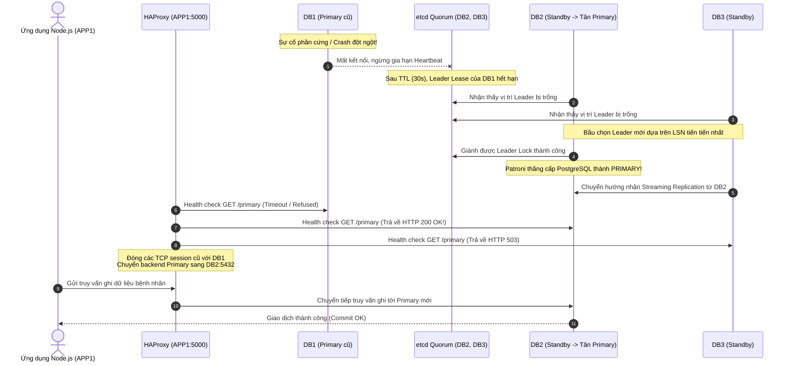

# KIẾN TRÚC HỆ THỐNG CƠ SỞ DỮ LIỆU DỰ PHÒNG CHO QUẢN LÝ BỆNH VIỆN

Dự án nghiên cứu và xây dựng giải pháp High Availability (HA) cho Cơ sở dữ liệu Quản lý Bệnh viện trên nền tảng 5 máy chủ Ubuntu Server 24.04 LTS.

---

## 1. Tổng Quan Kiến Trúc (5 Máy Chủ Độc Lập)

Hệ thống được thiết kế theo mô hình phân tán, không có điểm lỗi đơn (No Single Point of Failure - SPOF) ở tầng CSDL và tầng điều phối cụm, đồng thời tách biệt tầng ứng dụng và tầng sao lưu giám sát.

```mermaid
flowchart TD
    subgraph CLIENTS["TẦNG TRUY CẬP NGƯỜI DÙNG"]
        UserBrowser["Trình duyệt / Bác sĩ / Lễ tân"]
    end

    subgraph APP_TIER["MÁY 4: APP1 (100.99.89.64 - Tailscale)"]
        NodeApp["Node.js + Express API\n(Hospital REST API - Port 3000)"]
        HAProxy["HAProxy Dynamic Routing\n(Port 5000: Write | Port 5001: Read)"]
    end

    subgraph DB_CLUSTER["CỤM POSTGRESQL HA (3-NODE DCS QUORUM QUA TAILSCALE)"]
        subgraph DB1_NODE["MÁY 1: DB1 (100.115.205.94)"]
            PG1["PostgreSQL 14 (Primary ban đầu)"]
            Patroni1["Patroni Agent (Port 8008)"]
            etcd1["etcd Member 1 (Port 2379/2380)"]
        end

        subgraph DB2_NODE["MÁY 2: DB2 (100.97.242.2)"]
            PG2["PostgreSQL 14 (Standby 1)"]
            Patroni2["Patroni Agent (Port 8008)"]
            etcd2["etcd Member 2 (Port 2379/2380)"]
        end

        subgraph DB3_NODE["MÁY 3: DB3 (100.67.87.46)"]
            PG3["PostgreSQL 14 (Standby 2)"]
            Patroni3["Patroni Agent (Port 8008)"]
            etcd3["etcd Member 3 (Port 2379/2380)"]
        end
    end

    subgraph MON_TIER["MÁY 5: MON1 (100.87.112.76) - ĐỘC LẬP VỚI QUORUM"]
        Prometheus["Prometheus Server (Port 9090)"]
        Grafana["Grafana Dashboards (Port 3001)"]
        pgBackRest["pgBackRest Central Repo\n(/var/lib/pgbackrest)"]
    end

    UserBrowser -->|HTTP Requests| NodeApp
    NodeApp -->|SQL Queries (Localhost:5000)| HAProxy
    
    HAProxy -.->|Health Check GET /primary| Patroni1
    HAProxy -.->|Health Check GET /primary| Patroni2
    HAProxy -.->|Health Check GET /primary| Patroni3
    
    HAProxy ==>|TCP 5432 (Chỉ định tuyến tới Primary)| PG1
    
    PG1 ===|Streaming Replication (WAL)| PG2
    PG1 ===|Streaming Replication (WAL)| PG3
    
    Patroni1 <--->|Raft Consensus / Heartbeat| etcd1
    Patroni2 <--->|Raft Consensus / Heartbeat| etcd2
    Patroni3 <--->|Raft Consensus / Heartbeat| etcd3
    etcd1 <===>|Peer Sync 2380 (Quorum 2/3)| etcd2
    etcd2 <===>|Peer Sync 2380 (Quorum 2/3)| etcd3
    etcd3 <===>|Peer Sync 2380 (Quorum 2/3)| etcd1
    
    PG1 -.->|WAL Archiving SSH| pgBackRest
    Prometheus -.->|Scrape Metrics 9100, 9187, 8008, 2379| DB1_NODE
    Prometheus -.->|Scrape Metrics 9100, 9187, 8008, 2379| DB2_NODE
    Prometheus -.->|Scrape Metrics 9100, 9187, 8008, 2379| DB3_NODE
    Prometheus -.->|Scrape Metrics 9100, 7000| APP_TIER
    Grafana -->|Query Metrics| Prometheus
```

---

## 2. Phân Tích Kỹ Thuật Các Thành Phần

### 2.1. Cụm Cơ Sở Dữ Liệu: DB1, DB2, DB3 (PostgreSQL 14/16 + Patroni + etcd)
- **PostgreSQL 14 (Ubuntu 22.04) / 16 (Ubuntu 24.04)**: Động cơ CSDL quan hệ chính thống, cấu hình tham số WAL mức `replica`, cho phép replication slots và `wal_log_hints` để hỗ trợ `pg_rewind`.
- **etcd v3**: Hệ thống lưu trữ khóa-giá trị phân tán (Distributed Configuration Store - DCS).
  - Cụm 3 thành viên trên DB1, DB2, DB3 tạo thành Quorum $Q = \lfloor 3/2 \rfloor + 1 = 2$ thành viên.
  - Sử dụng giải thuật đồng thuận Raft để bảo đảm tính nhất quán mạnh mẽ (Linearizable consistency).
  - Khi 1 node bất kỳ gặp sự cố (ví dụ DB1 sập), 2 node còn lại (DB2 và DB3) vẫn đạt Quorum (2/3) và tiếp tục vận hành.
- **Patroni**:
  - Tiến trình điều phối HA đóng vai trò là Process Supervisor cho PostgreSQL.
  - Duy trì Leader Lock trên etcd với cơ chế Time-To-Live (TTL 30 giây, loop_wait 10 giây).
  - Cung cấp REST API tại cổng `8008`:
    - `GET /primary` hoặc `GET /master`: Trả về `HTTP 200 OK` nếu node đang là Primary; trả về `HTTP 503 Service Unavailable` nếu là Standby.
    - `GET /replica` hoặc `GET /standby`: Trả về `HTTP 200 OK` nếu node là Standby khỏe mạnh.
  - Tích hợp `pg_rewind`: Khi một Primary cũ bị sập và tái khởi động sau khi một Standby đã được thăng cấp, Patroni tự động chạy `pg_rewind` để tua lại các WAL phân kỳ về điểm chia tách timeline, biến node cũ thành Standby an toàn mà không cần sao chép lại toàn bộ dữ liệu từ đầu.

### 2.2. Máy Ứng Dụng: APP1 (Node.js API + HAProxy)
- **HAProxy 2.8+**:
  - Lắng nghe tại cổng `5000` (Read-Write) và `5001` (Read-Only).
  - Định kỳ mỗi 3 giây gửi HTTP request kiểm tra endpoint `/primary` của Patroni trên cả 3 DB node.
  - Khi node Primary thay đổi sau failover, HAProxy tự động kích hoạt cờ `on-marked-down shutdown-sessions` để đóng ngay các phiên TCP cũ và chuyển toàn bộ lưu lượng mới sang Primary vừa được thăng cấp.
- **Node.js Hospital REST API**:
  - Xây dựng trên Express framework, kết nối CSDL qua `pg.Pool` trỏ tới `127.0.0.1:5000` (HAProxy).
  - Tích hợp lớp bọc truy vấn tự phục hồi (`queryWithRetry`) với thuật toán Exponential Backoff, giúp ứng dụng không bị sập (crash) trong khoảng thời gian failover xảy ra (10 – 25 giây).
  - Toàn bộ câu lệnh SQL sử dụng Parameterized Queries loại trừ nguy cơ SQL Injection.

### 2.3. Máy Giám Sát & Sao Lưu: MON1 (Prometheus + Grafana + pgBackRest)
- **Tính độc lập kiến trúc**: MON1 **hoàn toàn không tham gia vào Quorum etcd**. Nếu máy MON1 bị ngắt điện, hỏng phần cứng hoặc bảo trì, cụm PostgreSQL (DB1, DB2, DB3) và ứng dụng (APP1) vẫn tiếp tục xử lý các giao dịch khám chữa bệnh bình thường.
- **pgBackRest**:
  - Lưu trữ bản sao lưu tập trung tại `/var/lib/pgbackrest`.
  - Hỗ trợ Full Backup định kỳ và Differential Backup hàng ngày.
  - Kết hợp với WAL Archiving liên tục cho phép khôi phục về bất kỳ thời điểm nào trong quá khứ (Point-In-Time Recovery - PITR).
- **Prometheus & Grafana**:
  - Thu thập metrics tài nguyên từ `node_exporter` trên cả 5 máy chủ.
  - Thu thập trạng thái CSDL từ `postgres_exporter` và Patroni REST API.
  - Cung cấp Dashboard trực quan hiển thị Replication Lag, TPS, CPU, RAM, Disk và cảnh báo sớm nguy cơ tràn dung lượng.

---

## 3. Quy Trình Hoạt Động & Chu Trình Failover

### 3.1. Trạng Thái Vận Hành Bình Thường (Normal State)
1. DB1 giữ etcd Leader Lock, PostgreSQL trên DB1 ở vai trò Primary (Read-Write).
2. DB2 và DB3 đóng vai trò Standby (Read-Only), duy trì kết nối Streaming Replication nhận WAL liên tục từ DB1.
3. Patroni trên DB1 định kỳ mỗi 10 giây gia hạn Lease trên etcd.
4. HAProxy trên APP1 kiểm tra `/primary`: DB1 trả về `200 OK`, DB2 & DB3 trả về `503`. Mọi kết nối ghi từ API cổng 5000 được gửi đến DB1.
5. Mỗi giao dịch commit trên DB1 được ghi vào WAL và gửi sang DB2, DB3.
6. DB1 đẩy các file WAL đã đóng sang kho lưu trữ pgBackRest trên MON1 qua SSH.

### 3.2. Quy Trình Tự Động Failover Khi DB1 Gặp Sự Cố (Failure Sequence)


